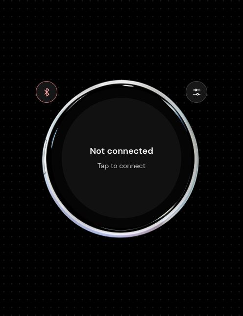
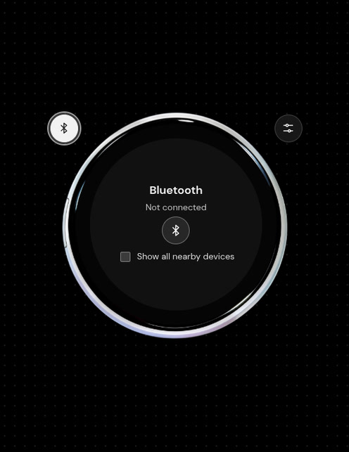
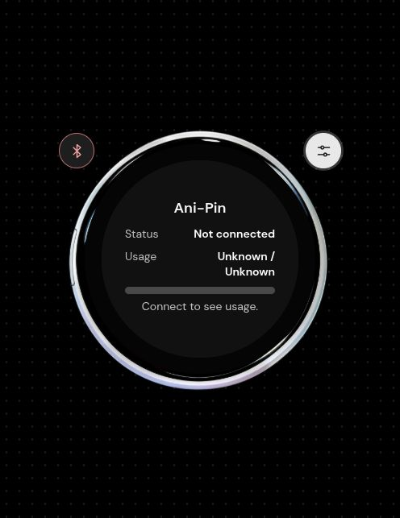

<div align="center">
  <a href="https://jovalle.github.io/kingpin/"></a>

  <h1>Kingpin</h1>

  <p><strong>Your badge, your canvas</strong></p>

  <p>
    <a href="https://github.com/jovalle/kingpin/releases"></a>
    <a href="https://jovalle.github.io/kingpin/"></a>
    <a href="https://github.com/jovalle/kingpin/actions/workflows/deploy.yml"></a>
  </p>

  <p>
    
    
    
    
  </p>
</div>

---

##  Overview

Kingpin is a browser-based editor for the Ani-Pin badge. Convert images, GIFs, and browser-supported videos into the badge's 368 × 368 format, preview the result, and send it over Bluetooth.

Media is processed locally in your browser and sent directly to the badge. It is not uploaded for processing.

##  Features

- 🖼️ **Images and animation** — Use still images, GIFs, or browser-supported videos.
- 🎞️ **Slideshow creator** — Combine two or more still images into a looping animation.
- 🔍 **Crop and preview** — Reposition and zoom before sending.
- 📡 **Direct Bluetooth transfer** — Connect to your badge from a supported browser.
- 🔒 **Local processing** — Animations are sampled at 10 frames per second, up to 60 seconds. Audio is not transferred.

##  Quick Start

Open **[jovalle.github.io/kingpin](https://jovalle.github.io/kingpin/)**, connect your badge using the Bluetooth controls, and choose an image, GIF, or video.

Adjust its position and zoom before sending.

Web Bluetooth requires a supported browser and a secure context. Availability varies by browser and operating system.

##  Screenshots

| Home                                                     | Bluetooth settings                                                         | Badge information                                                              |
| -------------------------------------------------------- | -------------------------------------------------------------------------- | ------------------------------------------------------------------------------ |
|  |  |  |

##  Local Development

Requires Node.js 22 or newer.

```sh
npm install
npm run dev
```

Open the local address printed by Vite. It starts at port 5464 (KING on a phone keypad) and automatically tries the next available port if that one is in use. Run `npm test` for the browser logic tests and `npm run build` for a production build.

On Linux, macOS, and Windows, the repository helper can enable the experimental web-platform flag in most Chromium-based browsers (tested with Helium on Debian). Web Bluetooth is generally available without this flag on macOS and Windows; try it if your browser does not expose Bluetooth. The helper requires Node.js and Python 3.

##  Deployment and Releases

Pushes to `main` test and deploy the static site to GitHub Pages. Semantic releases are generated from conventional commits after a successful deployment. The release badge shows a version after the first release.
